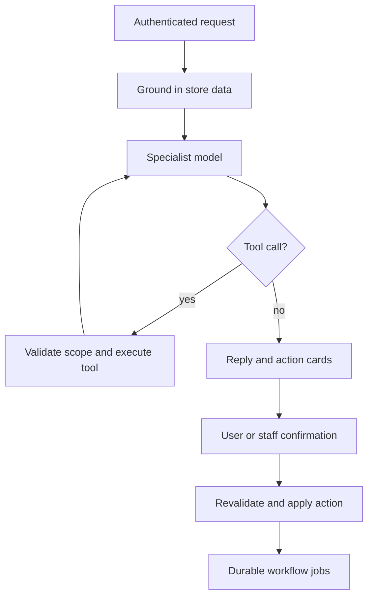

# 22 specialist roles and 17 requested capabilities

The customer-facing entry points are `/agents/`, `/assistant/` and `/ai-studio/`. Staff additionally use `/intelligence/` and `/operations/`.

| # | Capability | Actual implementation | Data/model needed |
| --- | --- | --- | --- |
| 1 | Personal Shopping | Catalogue search, exact product/variant facts, comparisons through LLM tool results, confirmed add-to-bag proposals | Catalogue; Gemini for conversation |
| 2 | Visual Search | Central garment colour-histogram similarity; Gemini garment description + catalogue ranking | Uploaded photo; Gemini key and consent for semantic mode |
| 3 | Virtual Try-On | Consent-based FASHN submission/status adapter; private generated output, access checks and deletion | Separate configured try-on provider/key; no fake fallback |
| 4 | Voice Shopping | Browser speech recognition, editable Tamil/English transcript, shopping tools and guarded cart actions | Supported browser/microphone; browser service may process audio |
| 5 | Business Intelligence | Collected cash, processed refunds, known-cost coverage, purchase-based customer segments | Actual order and cost records; not an accounting profit claim |
| 6 | Demand Forecasting | 56-day EWMA baseline, 14-day estimate, daily backtest MAE; insufficient-history states | At least 28 days of observed history and 5 units; not a guarantee |
| 7 | Supplier Intelligence | MOQ/landed-cost comparison, lead time, actual on-time/defect metrics; draft/approve/receive internal POs | Supplier quotes and recorded receipts |
| 8 | Pricing Intelligence | Recent comparable competitor median, cost-based 35% margin floor, reviewed price proposals | Actual cost and recorded competitor observations |
| 9 | Inventory Optimization | Stock/lead-time/incoming-PO-based reorder recommendations and inspected receipts | Variant stock, supplier lead time and history |
| 10 | Marketing Strategy | Purchase segments, campaign drafts, reviewed approvals and consent-rechecked outbox delivery | Opted-in customers; SMTP for real external email |
| 11 | Customer Retention | Repeat/inactive-90-day segments and reviewed retention campaigns | Recorded purchases/customer dates and opt-in |
| 12 | Cart Recovery | Abandoned snapshots, conversion recheck, opt-in reminder queue and eligible coupon help | Customer consent; no invented reason for abandonment |
| 13 | Content Generation | Product copy and structured title/meta/tags drafts; guarded publish and pricing actions | Real product facts; LLM for generation |
| 14 | Fraud Investigation | Explainable velocity/shared-phone/high-value signals, verification holds and reviewed release | Order/account history; no automatic accusation/ban |
| 15 | Return Investigation | Return reasons, paid-order history, published window, request review and physical inspection workflow | Actual request/order/policy records |
| 16 | Logistics Optimization | Forward/reverse/replacement shipping, delay review, local coordinate-based route planning | Courier account; coordinates for local-route planning |
| 17 | Autonomous Business Manager | Combines live facts into action plans; daily persisted report and internal priority tasks | Store records; guarded changes use normal permissions |

Core cart, checkout, payment, order support, fulfillment and inventory specialists are also retained. Their overlapping roles share the same audited business services instead of implementing conflicting rules.

## How the LLM executes safely and usefully

LangChain provides `ChatGoogleGenerativeAI` for Gemini (optional `ChatOpenAI` retained). LangGraph runs:

Model tool loops are bounded. Only the current user's orders are available to customer agents. Staff tools require staff permissions. There is no shared cross-user LangGraph checkpointer. The short conversation history is in the authenticated Django session and can be cleared.

A proposal is not execution. It displays the exact server-authored effect and expires after 15 minutes. Confirmation rechecks ownership, permissions, prices, stock and policy. Duplicate confirmation of the same action returns the saved result.

A worker event is different: after verified payment or an approved physical step, configured workflows execute without needing a model to repeat fixed rules. Owner policy controls autonomous live refunds.

## No-key demo commands

Choose the relevant specialist:

- Cart: `add VARIANT_ID 1`, `remove VARIANT_ID`, `coupon WELCOME10`.
- Order support: `cancel AB-XXXXXXXX`.
- Returns: `return ITEM_ID reason`, `exchange ITEM_ID L reason`.
- Shipping/admin: `pack AB-XXXXXXXX`, `track-shipment SHIPMENT_ID`.
- Inventory/admin: `receive PLAN_ID QUANTITY`.
- Returns/admin: `approve-return REQUEST_ID`, `inspect-return REQUEST_ID`, `refund-return REQUEST_ID`.
- Admin: `refund AB-XXXXXXXX`, `retry JOB_UUID`.
- Catalogue: `description PRODUCT_ID new description`, `price PRODUCT_ID 2499`.

Product cards in assistant results also offer a size/colour selector and **Prepare add to bag**. Operations/intelligence pages provide the same approval flow without requiring an LLM. In real model mode, use natural language instead of memorizing command syntax.

## Honest boundaries

Agents do not fabricate supplier quotes, scrape arbitrary competitor sites, guarantee demand/profit, control third-party courier route planning, physically pack stock or inspect returns. Forecasts and route plans are transparent baselines. The separate try-on provider is required for genuine image generation. These boundaries are displayed/documented instead of being replaced by successful-looking placeholders.

## Exact role registry

- stylist: Shopping & Styling Agent
- support: Order & Customer Support Agent
- admin: Admin Operations Agent
- cart: Cart & Checkout Agent
- payments: Payment Assistance Agent
- returns: Returns & Exchange Agent
- inventory: Inventory & Restock Agent
- shipping: Shipping & Tracking Agent
- content: Catalogue & Merchandising Agent
- business: Business Intelligence Agent
- forecast: Demand Forecasting Agent
- suppliers: Supplier Intelligence Agent
- pricing: Pricing Intelligence Agent
- inventory_optimizer: Inventory Optimization Agent
- marketing: Marketing Strategy Agent
- retention: Customer Retention Agent
- fraud: Fraud Investigation Agent
- return_investigator: Return Investigation Agent
- logistics: Logistics Optimization Agent
- manager: Autonomous Business Manager
- voice: Voice Shopping Agent
- recovery: Cart Recovery Agent
